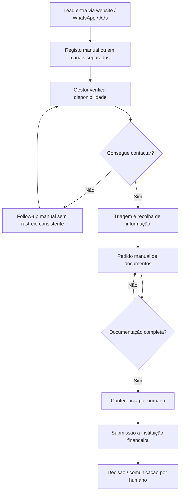
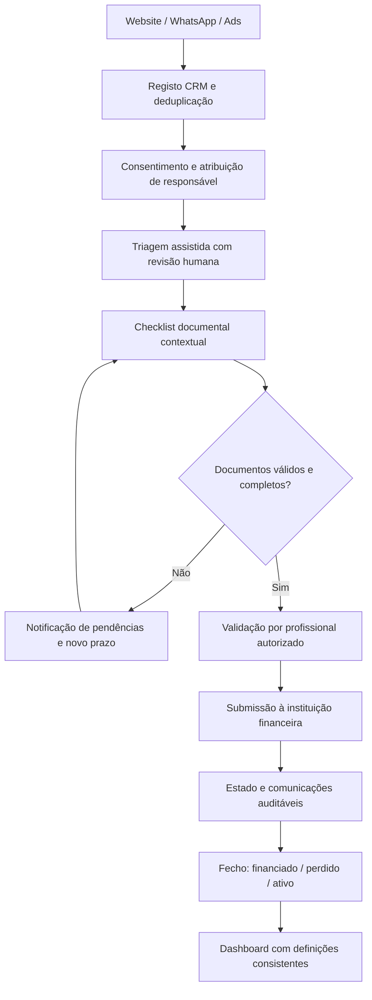

# 02 — Process analysis: AS-IS and TO-BE

Os diagramas Mermaid abaixo são esquemas conceptuais de síntese, não BPMN. A modelação formal inicial está nos ficheiros BPMN 2.0 XML com BPMN DI: **[AS-IS](../bpmn/AS-IS.bpmn)** e **[TO-BE](../bpmn/TO-BE.bpmn)**. Consulta o **[guia BPMN](../bpmn/GUIA-BPMN.md)** para compreender pools, lanes, eventos, gateways, message flows, pressupostos e limitações. Ambos são modelos analíticos não executáveis, ainda sujeitos a validação com stakeholders.

## AS-IS hipotético

**Riscos a confirmar em entrevista:** duplicação de leads; responsabilidade indefinida; ausência de trilho de auditoria; pedidos de documentos redundantes; fontes de lead não reconciliadas.

## TO-BE proposto para piloto

## Pontos de controlo
1. O chatbot não aprova crédito nem valida legalmente a documentação de forma autónoma.
2. Regras de recolha documental apenas após definição jurídica de finalidade, minimização, base legal e retenção.
3. O cliente deve poder falar com uma pessoa e contestar/corrigir dados.
4. Cada transição precisa de timestamp, responsável, origem e razão da alteração.
5. Integrações WhatsApp, webform e CRM necessitam autenticação, logging e tratamento de duplicados.

## O que medir antes e depois
- Tempo para primeiro contacto, qualificação e submissão.
- Percentagem de dossiês devolvidos por documentação incompleta.
- Número de interações manuais por processo.
- Taxa de qualificação e de financiamento com segmentos comparáveis.
- Incidentes, reclamações e erros no tratamento de dados.

## Lacunas por validar
Volumes reais, disponibilidade de integrações, requisitos regulamentares aplicáveis, custo de licenças, acessos e permissões, política de conservação documental.
